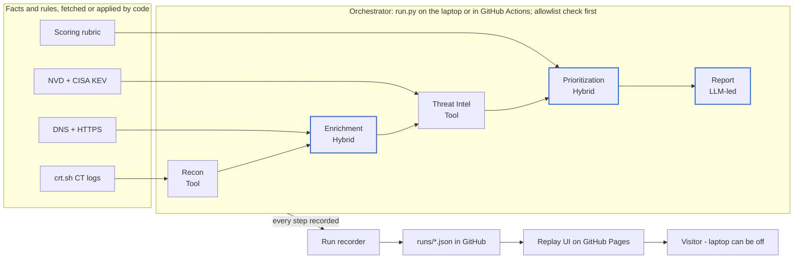

# Attack Surface Analyst — PRD & Architecture

Version 0.1 · Nov 1, 2026 · Miki Sharon

> The living version of this document is a shared Claude doc. This file is the copy that the code is built against; update it when the doc changes.

## Overview

Attack Surface Analyst turns a single domain name into a prioritized, evidence-backed external exposure report, produced by five cooperating agents. It is a working demonstration of how to decide where an LLM adds value, where it must not be trusted, and how the result is evaluated.

**Problem.** Security teams cannot protect assets they do not know about. Forgotten subdomains, outdated internet-facing software and known-exploited vulnerabilities are a leading entry point for attackers. Commercial EASM platforms solve this at scale; this demo reproduces the core workflow in a transparent, explainable way.

**Why multiple agents.** Each step has a different nature: discovery and matching are factual and must be exact, while classification, prioritization and reporting need judgment and language. Splitting the work lets each step use the right technique, be tested on its own, and be shown step by step in the UI.

**Design principle.** Code fetches facts; the LLM reasons over facts and never invents them. Every finding in the final report traces back to a piece of evidence with a source.

## Users and use cases

The primary user is a technical external user who wants to see how a multi-agent AI system handles a real security workflow; the output is designed to be credible to security practitioners and clear to non-technical readers.

| Persona | Context | What they need from the demo |
| --- | --- | --- |
| Technical external user | Opens the live demo from a link, spends 3–5 minutes | Understand the system: problem framing, agent design, LLM-vs-code decisions, evals and guardrails |
| Security leader | Knows EASM and CTI well | Findings that are correct, evidence-backed and prioritized the way a real team would |
| Non-technical user | No security or AI background, spends about a minute | A clear story and a visibly working product |
| Admin / operator | Runs scans locally or via scheduled CI | Simple CLI, reproducible runs, easy to add new demo targets |

Core use cases:

1. A visitor picks a recorded scan and watches the agents work step by step, ending with the report.
2. A visitor opens any finding and sees the evidence behind it: source, timestamp and which agent produced it.
3. The admin runs a new scan on an approved target and publishes it to the site with one commit.

## Goals and non-goals

The demo succeeds if a reviewer understands the agent design and trusts the findings within five minutes.

**Goals**

- Demonstrate a working multi-agent pipeline with a clear split between deterministic tools and LLM reasoning.
- Produce findings where every claim is traceable to evidence.
- Show an evaluation approach with measured results, not just a working happy path.
- Run at zero hosting cost, with the public site available 24/7 while the laptop is off.

**Non-goals**

- Not a production EASM product: no continuous monitoring, alerting or multi-tenant accounts.
- No active scanning beyond minimal, polite HTTP requests to the target's own web pages (no port scans, no exploitation, no brute forcing).
- No live scanning by website visitors; the public site replays recorded runs only.
- No scans or published reports on organizations that have not authorized it.

## Functional requirements

P0 is the first public release (all five agents, recorder and replay UI); P1 makes it credible to a security reviewer; P2 is stretch.

| ID | Requirement | Owner | Priority |
| --- | --- | --- | --- |
| FR-1 | Accept a domain and refuse it unless it is on the authorized-targets allowlist | Orchestrator | P0 |
| FR-2 | Discover subdomains from certificate transparency logs (crt.sh); drop wildcards, deduplicate, record the source per subdomain | Recon | P0 |
| FR-3 | Resolve DNS (A, AAAA, CNAME) and fetch each live host's HTTPS response headers and page title: one request per host, 10 s timeout, identifying User-Agent | Enrichment (tools) | P0 |
| FR-4 | Classify each live host's role (e.g. VPN portal, admin panel, API, staging, marketing) and business importance, citing evidence IDs | Enrichment (LLM) | P0 |
| FR-5 | Map detected product and version to CVEs (NVD API) and flag those in the CISA Known Exploited Vulnerabilities catalog | Threat Intel | P0 |
| FR-6 | Assign each finding a priority P1–P4 from a rule-based baseline, adjusted by the LLM with a written rationale | Prioritization | P0 |
| FR-7 | Write an executive summary (max 150 words) and a technical findings table; every claim cites evidence IDs | Report | P0 |
| FR-8 | Save every agent's output envelope with timestamps to one run file per scan | Run recorder | P0 |
| FR-9 | Replay UI: pick a recorded scan, watch agents run in sequence, browse findings, open the evidence behind each one, read the report | Web UI | P0 |
| FR-10 | When a data source fails, mark the step degraded, record why, and continue the pipeline | All agents | P1 |
| FR-11 | Run scans weekly via a scheduled GitHub Actions workflow and commit the new run files | CI | P1 |
| FR-12 | Evaluation harness: run the golden set and print the metrics in the next section | Eval | P1 |
| FR-13 | Show duration, LLM tokens and estimated cost per agent in the UI | Web UI | P1 |
| FR-14 | Adaptive recon: LLM proposes likely subdomain names; only names confirmed by DNS are kept | Recon | P2 |
| FR-15 | Local live mode: a FastAPI server streams a live run to the same UI | Backend | P2 |
| FR-16 | Compare two runs of the same target: new and removed assets and findings | Web UI | P2 |

## Success metrics and evaluation plan

Quality is measured per agent against a small golden set labelled by hand by a security expert; the targets below are starting proposals to confirm after the first runs.

**Golden set.** 3 authorized targets (the operator's own domain, scanme.nmap.org, a vulnweb.com test site), plus 10 synthetic host records with known correct answers (e.g. a fake host running a KEV-listed product version). Synthetic records make the LLM agents testable without depending on live internet data.

| Agent | Metric | How it is measured | Proposed target |
| --- | --- | --- | --- |
| Recon | Subdomain recall | Found subdomains vs. a manually verified list per target | ≥ 90% |
| Enrichment (LLM) | Role classification accuracy | LLM label vs. expert label on golden hosts | ≥ 80% |
| Threat Intel | CVE match precision | Share of reported CVEs that truly apply to the detected version | ≥ 95% |
| Prioritization | Agreement with expert ranking | Share of findings where LLM priority equals the expert's, or is one level off | ≥ 85% within one level |
| Report | Faithfulness | Claims in the report without a valid evidence ID | 0 |
| All LLM agents | Schema validity | Outputs that pass JSON schema validation on the first try | ≥ 95% |
| Pipeline | Cost and time per run | Recorded tokens and duration | < $0.10 and < 3 min per target |

**Engagement metrics.** Visitors who open the demo from the project page, and average time on the demo (via a privacy-friendly free analytics tool, if added).

**Process.** Every prompt or skill change is followed by a full eval run; results are kept in `evals/results.md` with the date, so quality can be tracked across versions.

## Guardrails, scope control and responsible use

The demo only scans targets that permit it, never lets the LLM invent facts, and never exposes secrets.

**Scope control**

- An allowlist file (`config/targets.yaml`) lists authorized targets; the orchestrator refuses anything else before any request is made.
- Allowed targets: the operator's own domain, scanme.nmap.org (Nmap's public test host) and Acunetix's intentionally vulnerable vulnweb.com sites.
- Recon is passive (certificate transparency only). Enrichment makes one HTTPS request per discovered host, with a clear User-Agent such as `AttackSurfaceAnalyst-demo (+link to project page)`.
- Hosts from certificate logs that resolve outside the target's domain are recorded but not contacted.

**LLM guardrails**

- LLM agents receive only structured evidence and must return JSON that matches a schema; invalid output is retried once, then the step is marked degraded.
- Every LLM claim must reference evidence IDs from its input; the recorder rejects claims that cite unknown IDs (this is the faithfulness check).
- Content fetched from target pages (titles, headers) is treated as untrusted data, never as instructions, which limits prompt injection through a malicious page title.
- Temperature is set low for classification and prioritization so reruns stay consistent.

**Secrets and data**

- The LLM API key lives in `.env` locally and in GitHub Actions secrets in CI; `.env` is in `.gitignore`.
- Run files contain only public information about authorized targets.

## Architecture overview

The agents run in sequence under one orchestrator; their recorded output is the only thing the public site needs.



Blue-bordered agents use the LLM, over evidence only. Each agent adds evidence and output to the run; the recorder saves it as JSON in the repo, and the static site replays it at any time.

## Agents and the LLM-vs-code decision

Two agents are pure tools, two are hybrid, and one is LLM-led: the model is used only where judgment or language is needed.

| Agent | Kind | Input | Output | Code does | LLM does |
| --- | --- | --- | --- | --- | --- |
| Recon | Tool | Target domain | Subdomain list with sources | Queries crt.sh, parses, deduplicates | Nothing in P0 (P2: proposes names that DNS must confirm) |
| Enrichment | Hybrid | Subdomains | Host profiles: IPs, headers, title, product/version, role, importance | DNS lookups, one HTTPS fetch per host, header parsing | Classifies host role and business importance from the evidence |
| Threat Intel | Tool | Host profiles | CVE findings (CVSS, KEV flag) plus rule-based exposure findings | NVD lookups by product/version, KEV catalog match | Nothing; matching must be exact and reproducible |
| Prioritization | Hybrid | Host profiles + findings | Priority P1–P4 per finding with rationale | Computes the baseline score from the scoring rubric | Adjusts by at most one level, with a written reason citing evidence |
| Report | LLM-led | Prioritized findings | Executive summary + technical table | Builds the table from data and validates citations | Writes the summary and recommendations |

**Decision rule used for every step**

1. An authoritative source exists for the fact → fetch it with code.
2. The transformation is exact and rule-based (parse, deduplicate, match a version) → code.
3. It needs interpretation, judgment or natural language → LLM, over evidence only.
4. The next step depends on what was just found → LLM may choose the next tool, and code verifies the result.

Each agent has its own `SKILL.md` in `skills/`. For tool agents it is the specification and runbook; for LLM agents it is also the instruction set loaded at runtime.

## Data contract

Every agent returns the same envelope, and every fact lives in a shared evidence list that later agents cite by ID. This one contract is what makes the pipeline chainable, testable and replayable. Full rules: `skills/_shared/conventions.md`.

**Agent envelope**

```json
{
  "agent": "enrichment",
  "version": "0.1.0",
  "status": "ok",
  "started_at": "2026-11-08T10:00:02Z",
  "finished_at": "2026-11-08T10:00:41Z",
  "input_ref": "recon",
  "output": { },
  "evidence": [ ],
  "errors": [ ],
  "llm_usage": { "model": "...", "input_tokens": 0, "output_tokens": 0 }
}
```

- `status` is one of `ok`, `degraded` (partial result, reason in `errors`) or `failed`.
- `output` is agent-specific and defined in each agent's `SKILL.md`.
- `llm_usage` is `null` for tool agents.

**Evidence item**

```json
{
  "id": "ev-enr-0007",
  "type": "http_header",
  "subject": "portal.example.com",
  "value": "Server: nginx/1.18.0",
  "source": "https://portal.example.com/",
  "collected_at": "2026-11-08T10:00:17Z"
}
```

Evidence IDs are prefixed by agent (`ev-rec-`, `ev-enr-`, `ev-ti-`) so a citation shows where the fact came from.

**Run file** (`runs/<target>-<YYYY-MM-DD>.json`)

```json
{
  "run_id": "scanme-nmap-org-2026-11-08",
  "target": "scanme.nmap.org",
  "pipeline_version": "0.1.0",
  "steps": [ "<recon envelope>", "<enrichment envelope>", "..." ],
  "summary": { "hosts": 0, "findings": 0, "p1": 0, "duration_s": 0, "cost_usd": 0 }
}
```

The UI replays `steps` in order, using `started_at` and `finished_at` to pace the animation. A `runs/index.json` file lists available runs for the target picker.

## Tech stack, repo layout and deployment

Python runs the agents, a static site replays the results, and GitHub hosts both for free.

| Layer | Choice | Why |
| --- | --- | --- |
| Agents and orchestrator | Python 3.11+, `requests`, `dnspython`, `pydantic` for schemas | Simple to read and write; schemas enforce the data contract |
| LLM | Claude API behind a small `llm.py` wrapper | One place to swap models or providers; records token usage |
| Data sources | crt.sh, DNS, target HTTPS pages, NVD CVE API, CISA KEV JSON feed | Free and public; NVD works without a key at lower rate limits |
| Web UI | Static HTML, CSS and vanilla JavaScript | No build step; easy to edit |
| Hosting | GitHub Pages from the `site/` folder | Free, always on, no server |
| Scheduling (P1) | GitHub Actions weekly workflow | Runs without the laptop; key stored as a repo secret |
| Live mode (P2) | FastAPI with server-sent events | Shows backend streaming skills locally |

**Repository layout**

```
attack-surface-analyst/
├── agents/              # recon.py, enrichment.py, threat_intel.py, prioritization.py, report.py
├── skills/              # one folder per agent, each with SKILL.md (+ reference/)
├── core/                # envelope.py, evidence.py, llm.py, recorder.py
├── config/targets.yaml  # authorized targets allowlist
├── evals/               # golden set, eval runner, results.md
├── runs/                # recorded run files + index.json
├── site/                # replay UI (index.html, app.js, styles.css)
├── docs/                # PRD, architecture, project page assets
├── run.py               # CLI: python run.py scanme.nmap.org
└── .github/workflows/   # scheduled scan (P1)
```

**Publishing flow.** `python run.py <target>` writes the run file and updates `runs/index.json`; a small script copies runs into `site/data/`; a push to `main` updates GitHub Pages.

## Risks, open questions and roadmap

The biggest risks are flaky free data sources and thin findings on test targets; both are handled by design rather than hoped away.

| Risk | Impact | Mitigation |
| --- | --- | --- |
| crt.sh is slow or returns errors | Recon returns nothing | Retry with backoff, then mark degraded; keep the last good result in the run file |
| NVD rate limits (no API key) | Threat Intel is slow | Cache CVE lookups locally; request a free NVD key if needed |
| Test targets expose few real vulnerabilities | The report looks empty | Add the synthetic host records from the golden set as a clearly labelled "training scenario" run |
| Version detection from headers is unreliable | Missed or wrong CVEs | Report version confidence; never match a CVE without an exact product and version |
| LLM output drifts after prompt changes | Silent quality loss | Eval run after every skill change; results tracked in `evals/results.md` |
| A reviewer questions scanning ethics | Reputational | Allowlist, passive-first design and an explicit "responsible use" note on the site |

**Open questions**

- [ ] Which LLM: Claude API pay-as-you-go (expected a few dollars in total) or a free-tier alternative?
- [ ] Is the operator's own domain enough of a real-world target, or should a second controlled domain be added?
- [ ] Include the synthetic training-scenario run on the public site?

**Roadmap**

1. Recon agent and project setup (no LLM)
2. Enrichment tools and Threat Intel agent (no LLM)
3. LLM layer: Enrichment classification, Prioritization, Report
4. Orchestrator and run recorder
5. Replay UI
6. Evals, project page, GitHub Pages deploy; then P1 items (scheduled CI, metrics panel)
